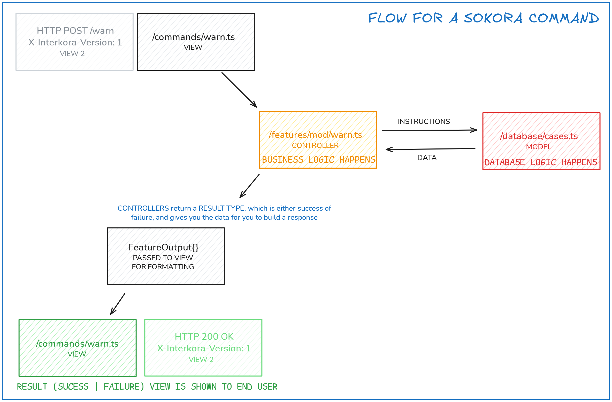

---
hide:
  - toc
---

# Features

There’s a `features` folder where we have (you guessed it!) Sokora’s features. Examples are `mod/ban`, `math/graph`, etc…

!!!important "Not all *features* are features"
    Weird wording, but that’s the thing. Not all _bot features_ are structured like this: only the ones that need to be usable by Interkora and not just Discord. Discord-only features are simpler; logic is in the command file as a classic bot would do. They don’t need specific documentation.

**Features are written in a very specific way** and are usable by both commands and Interkora (sometimes only the former, though). They do all the job except for the “rendering” of the resulting embed / HTTP resp / whatever. Within them, most of the code is feature logic. Database-related stuff is used but not implemented, all calls are done to wrappers over the database (like the already existing `createCase`, for example).

An example of a feature’s flow is this:



All features share a somewhat common shape (not final, might iterate):

```ts
interface Params {
  reason: string | null;
  guild: Guild;
  // ...
}

async function method(
  ...parameters: MethodParameters<Params, ModActionResult>
): Promise<FeatureOutput<ModActionResult>> {
  const [ok, fail, options] = parameters;
  const { reason, guild /* ... */ } = options;
  
}

export const warn = feature("mod/warn", method)
```

Let’s break this down:

**Parameters**: Self-describing. Ideally they should have TSDoc. Do not ask for an interaction or an event for interkorable features.

```ts
interface Params {
  reason: string | null;
  guild: Guild;
  // ...
}
```

**Method declaration**: Declare an async function named `method` (name doesn’t really matter; it’s a convention) and spreading the `MethodParameters<I, O>` type (this is imported).

```ts
async function method(
  ...parameters: MethodParameters<Params, ModActionResult>
): Promise<FeatureOutput<ModActionResult>>
```

In `MethodParameters<I, O>`, `I` is input (your params interface) and `O` is output (what the feature returns if successful; define this freely, the example uses `ModActionResult` which is shared across moderation features).

The return type is a promise of `FeatureOutput<O>`, where `O` is the same as in `MethodParameters`. `FeatureOutput` is needed as the return type of all features.

!!!info "You *could* pass a 2nd argument, as in `FeatureOutput<S, F>` where `S` is success output and `F` is failure output, however `F`’s default value can be spread into `buildErrorEmbed` so there’s little reason to override it."

From now on I’ll refer to `FeatureOutput<…>` as Result.

**Getting what you need**: You take parameters, then options, then you can work on the feature!

```ts
const [ok, fail, options] = parameters;
const { reason, guild /* ... */ } = options;

// below goes your actual logic
```

`...parameters` will give you _three_ parameters, where your actual params interface is the last one. First two are `ok` and `fail`, there are helpers to build the Result without much writing: `ok` takes `S` from Result and `fail` takes `F`

!!!tip
    `F`’s default type is this:

    ```ts
    type F = {
      title: string;
      reason?: string | undefined;
    }
    ```
