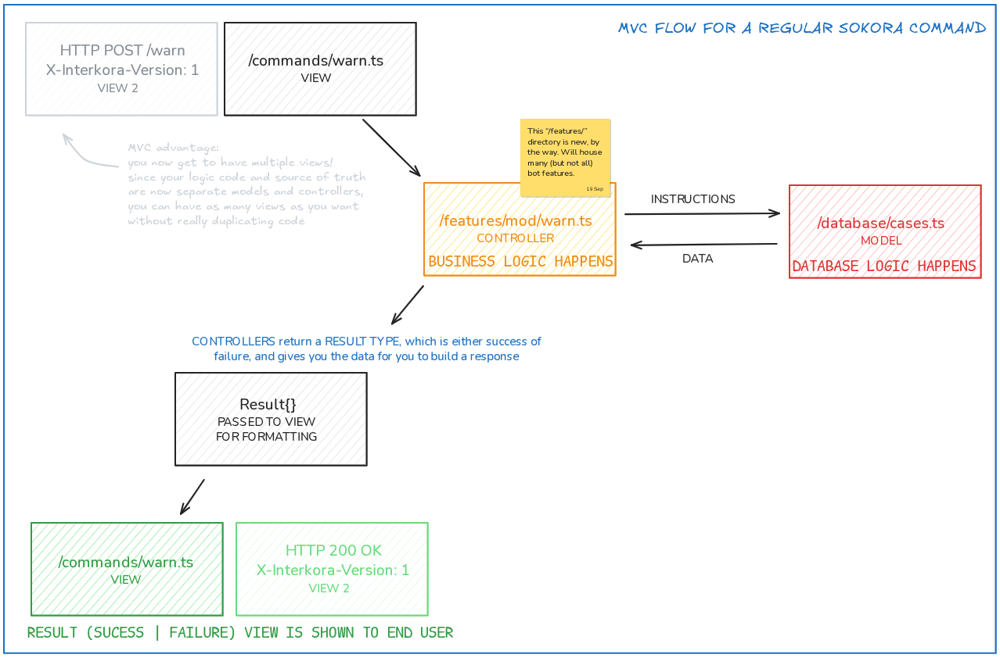

# Codebase structure

## Paradigm

!!!failure "Status"
    This reflects MVC branch. Main branch follows no structure at all.

**Sokora aims to follow the Model-View-Controller programming paradigm**. If you like reading, you can check [the Wikipedia page for MVC](https://en.wikipedia.org/wiki/Model%E2%80%93view%E2%80%93controller), but TL;DR:

- Views are what the user sees. They take data, present it, and offer buttons and stuff.
- Buttons and stuff call the controller, which is on a separate file. Controllers validate data and do business logic.
- Controllers that need to use the database or get data types refer to models, which are also separate on files.
- Models do database stuff and give their output back, simple enough.
- Controllers finish working and give data to the view for it to update.

Thus,

- Views can call controllers and controllers can call models, but never can a view call a model nor a model can call anything nor a controller can be inside of a view nor can everything be mixed up.

We’re not “purist” however, so solutions that are proven to be _better_ will take precedence over those that are _more compliant_. MVC just defines the *default* shape and thinking method.

## How this is actually structured

### Features

!!!failure "Status"
    This reflects MVC branch. Features don’t exit by themselves, code is split across command handlers and other things.

There’s a `features` folder where we have (you guessed it!) Sokora’s features. Examples are `mod/ban`, `math/graph`, etc…

**Features are written in a very specific way** and are usable by both commands and Interkora (sometimes only the former, though). They do all the job except for the “rendering” of the resulting embed / HTTP resp / whatever. Within them, most of the code is feature logic. Database-related stuff is used but not implemented, all calls are done to wrappers over the database (like the already existing `createCase`, for example).

An example of a feature’s flow is this:



All features share a somewhat common shape (not final, might iterate):

```ts
interface Params {
  reason: string | null;
  guild: Guild;
  // ...
}

async function method(
  ...parameters: MethodParameters<Params, ModActionResult>
): Promise<FeatureOutput<ModActionResult>> {
  const [ok, fail, options] = parameters;
  const { reason, guild /* ... */ } = options;
  
}

export const warn = feature("mod/warn", method)
```

Let’s break this down:

**Parameters**: Self-describing. Ideally they should have JSDoc. Do not ask for an interaction or an event for interkorable features.

```ts
interface Params {
  reason: string | null;
  guild: Guild;
  // ...
}
```

**Method declaration**: Declare an async function named `method` (name doesn’t really matter; it’s a convention) and spreading the `MethodParameters<I, O>` type (this is imported).

```ts
async function method(
  ...parameters: MethodParameters<Params, ModActionResult>
): Promise<FeatureOutput<ModActionResult>>
```

In `MethodParameters<I, O>`, `I` is input (your params interface) and `O` is output (what the feature returns if successful; define this freely, the example uses `ModActionResult` which is shared across moderation features).

The return type is a promise of `FeatureOutput<O>`, where `O` is the same as in `MethodParameters`. `FeatureOutput` is needed as the return type of all features.

!!!info "You *could* pass a 2nd argument, as in `FeatureOutput<S, F>` where `S` is success output and `F` is failure output, however `F`’s default value can be spread into `buildErrorEmbed` so there’s little reason to override it."

From now on I’ll refer to `FeatureOutput<…>` as Result.

**Getting what you need**: You take parameters, then options, then you can work on the feature!

```ts
const [ok, fail, options] = parameters;
const { reason, guild /* ... */ } = options;

// below goes your actual logic
```

`...parameters` will give you _three_ parameters, where your actual params interface is the last one. First two are `ok` and `fail`, there are helpers to build the Result without much writing: `ok` takes `S` from Result and `fail` takes `F`

!!!tip
    `F`’s default type is this:

    ```ts
    type F = {
      title: string;
      reason?: string | undefined;
    }
    ```

### Settings

!!!success "Status"
    This reflects both branches.

There’s a whole page on our settings module (as in how it works), but for its structure there’s not much to know.

You have a *database* file called `settings.ts` which defines all settings. Settings are added in so-called setting declarations, which look like this:

```ts
export const defCategory = {
  setting_one: {
    type: "BOOLEAN",
    val: true,
    desc: "Whether setting one is enabled. Defaults to true.",
  },
  setting_two: {
    type: "OBJECT",
    iterable: false,
    desc: "Nested setting.",
    properties: {
      something: {
        type: "BOOL",
        val: false,
        desc: ":)",
      },
      something_two: {
        type: "INTEGER",
        desc: ":) 2",
        val: 60,
      },
    },
  },
} satisfies SettingDefinitionRecord["settings"];
```

Each category is defined as `defName`, and is an object typed `SettingDefinitionRecord["settings"]`. Individual properties are documented with JSDoc so it’s easy to get how things work.

If you create a new `def`, add it to the main object.

```ts
export const settingsDefinition = {
  leveling: {
    description: "Customize the behavior of the leveling system.",
    settings: defLeveling,
  },
  moderation: {
    description: "Change Sokora’s settings related to moderation.",
    settings: defModeration,
  },
  // add it here...
} as const;
```

Also specify if it’s a user category or a server category by adding its key to either of the arrays below `settingsDefinition`.

```ts
export const serverSettingsKeys = [
  "easter",
  "leveling",
  // ...
] as (keyof TS)[];
export const userSettingsKeys = [
  "topgg",
  "leveling",
  // ...
] as (keyof TS)[];
```
