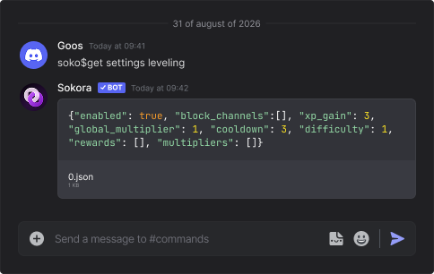

# Welcome to Interkora

An attempt at creating an extensible bot you can build on top of.

!!!danger "THIS IS AN EXPERIMENT!"
    Interkora is experimental. **We may change anything, rename something or break everything without prior notice**.

    Upon enabling Interkora will warn users about not being stabilized, and the API won’t enforce versioning until we consider we’ve reached a better than “good enough” result. We want to heavily rely on community feedback for this.

    !!!warning "It is also a work in progress"

        Most features are not implemented yet.

## Introduction

Power users like having command lines for the things they do and APIs for the things they use, and Interkora delivers both thing for the price of none. It adds

* **command-like instructions** that can be **stacked and used in a programmatic fashion**.
* (work in progress; soon) **HTTP APIs** that can be **queried and utilized safely**.
* (work in progress; soon) **a marketplace** for integrations built with this system to be **installed by users**.

!!! question "Wait, is this just a marketing stunt for text commands?"
    No. These are not text commands. Your typical slash commands are still slash only and do not work in a text-based fashion. Interkora is a different thing that *can* be used via text (and other ways too).

## A brief example

### Interkora text command

You can type the following command in the chat box, as if it was a terminal, to get data:

```bash title="message box"
soko$get settings welcome
```

And, assuming that:

- Interkora is enabled
- You’re authorized to use it

Sokora will respond with the data in a serializable format:

```json title="message from Sokora#1234"
{
  "join_text": "Welcome to (servername)!!",
  "leave_text": "(username) has left :(",
  ...
}
```

!!! note
    Output of `$get` queries is given in **attachments**, not in the message content.

In real life, it looks similar to this:



You can also (re)set settings.

```bash title="message box"
# change a setting
soko$set welcome.join_text "Hey, welcome to (servername)!"

# reset a setting
soko$reset welcome.join_text

# reset a whole category
# requires a different verb to avoid typos with $reset
soko$drop welcome
```

And many other things. Check the docs to learn more, serve yourself with the left sidebar.
